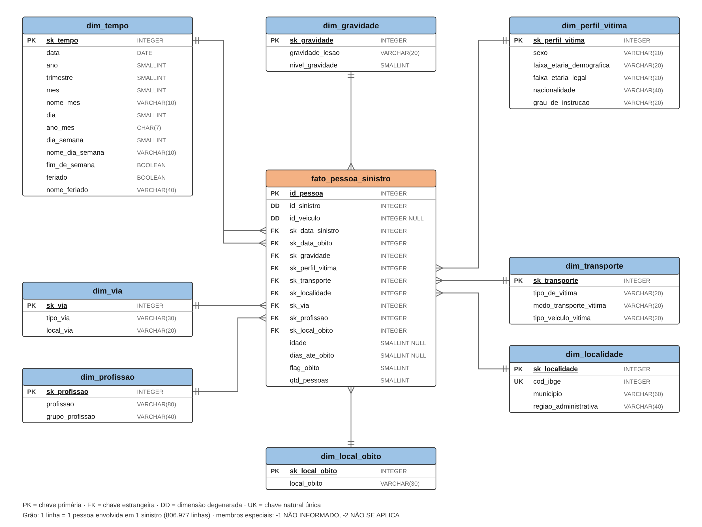

# Modelo estrela: Pessoas envolvidas em sinistros de trânsito (SP, 2021–2023)

- **Tarefa:** ETL-10 (issue #12)
- **Responsável:** Davi (@davi01mello)
- **Revisor:** Samuel (@safn007)
- **Diagrama:** [`modelo_estrela.drawio`](modelo_estrela.drawio) (fonte editável) e [`modelo_estrela.png`](modelo_estrela.png)
- **Status:** proposta para aprovação na reunião do grupo

## 1. Grão da tabela fato

**Uma linha da fato = uma pessoa envolvida em um sinistro.**

A fonte já está nesse grão: `id_pessoa` é único nas 806.977 linhas dos 36 arquivos (conferido na ETL-06 e na ETL-09). Por isso a fato terá exatamente **806.977 linhas**, e esse é o primeiro teste da validação pós-carga (ETL-25).

Um sinistro tem em média 2 pessoas (máximo 45). Para contar sinistros, use `COUNT(DISTINCT id_sinistro)`. Para contar pessoas, use `SUM(qtd_pessoas)`.

## 2. Tabelas (9 = 1 fato + 8 dimensões)

Toda dimensão tem uma chave substituta `sk_*` (inteiro gerado no ETL, não vem da fonte) e dois membros especiais:

| sk | Descrição | Quando usar |
| --- | --- | --- |
| `-1` | NÃO INFORMADO | O valor deveria existir, mas veio nulo, "NAO DISPONIVEL" ou inválido |
| `-2` | NÃO SE APLICA | O valor não faz sentido para a linha (ex.: data e local de óbito de quem não morreu) |

Assim, a fato **nunca tem FK nula**, e uma consulta com `JOIN` não perde linhas.

### fato_pessoa_sinistro

| Coluna | Tipo | Chave | Origem / regra |
| --- | --- | --- | --- |
| id_pessoa | INTEGER | PK | `id_pessoa`, dimensão degenerada |
| id_sinistro | INTEGER | | `id_sinistro`, dimensão degenerada (agrupa as pessoas do mesmo sinistro) |
| id_veiculo | INTEGER | | `id_veiculo`, dimensão degenerada; **nulo permitido** (pedestres e registros sem veículo, cerca de 21%) |
| sk_data_sinistro | INTEGER | FK → dim_tempo | `data_sinistro` |
| sk_data_obito | INTEGER | FK → dim_tempo | `data_obito`; `-2` quando não houve óbito |
| sk_gravidade | INTEGER | FK → dim_gravidade | `gravidade_lesao` |
| sk_perfil_vitima | INTEGER | FK → dim_perfil_vitima | combinação de sexo, faixas etárias, nacionalidade e escolaridade |
| sk_transporte | INTEGER | FK → dim_transporte | combinação de tipo de vítima, modo de transporte e veículo |
| sk_localidade | INTEGER | FK → dim_localidade | `cod_ibge` |
| sk_via | INTEGER | FK → dim_via | combinação de `tipo_via` e `local_via` |
| sk_profissao | INTEGER | FK → dim_profissao | `profissao` padronizada (ETL-17) |
| sk_local_obito | INTEGER | FK → dim_local_obito | `local_obito`; `-2` quando não houve óbito |
| idade | SMALLINT | | `idade` (0 a 102); nulo quando não informada (cerca de 1%) |
| dias_ate_obito | SMALLINT | | `tempo_sinistro_obito` (0 a 30); nulo quando não houve óbito |
| flag_obito | SMALLINT | | 1 se `data_obito` preenchida, senão 0 |
| qtd_pessoas | SMALLINT | | sempre 1 (medida aditiva para somar pessoas) |

**Medidas:** `qtd_pessoas` e `flag_obito` (aditivas), `idade` e `dias_ate_obito` (não aditivas: use média, mínimo e máximo).

### dim_tempo (role-playing: usada duas vezes pela fato)

| Coluna | Tipo | Observação |
| --- | --- | --- |
| sk_tempo | INTEGER PK | `AAAAMMDD` (ex.: 20210115); `-1` e `-2` para os membros especiais |
| data | DATE | |
| ano | SMALLINT | |
| trimestre | SMALLINT | 1 a 4 |
| mes | SMALLINT | 1 a 12 |
| nome_mes | VARCHAR(10) | JANEIRO, ... |
| dia | SMALLINT | |
| ano_mes | CHAR(7) | `2021-01` |
| dia_semana | SMALLINT | 1 = segunda ... 7 = domingo |
| nome_dia_semana | VARCHAR(10) | |
| fim_de_semana | BOOLEAN | |
| feriado | BOOLEAN | feriados nacionais (ETL-19) |
| nome_feriado | VARCHAR(40) | nulo se não for feriado |

O período vai de **01/01/2021 a 24/01/2024**: a maior `data_obito` é 24/01/2024, porque há óbitos até 30 dias depois de sinistros de dezembro de 2023. São 1.119 dias mais os 2 membros especiais.

### dim_gravidade

| Coluna | Tipo | Observação |
| --- | --- | --- |
| sk_gravidade | INTEGER PK | |
| gravidade_lesao | VARCHAR(20) | ILESO, LEVE, GRAVE, FATAL |
| nivel_gravidade | SMALLINT | 0 = ileso, 1 = leve, 2 = grave, 3 = fatal (permite ordenar e filtrar "grave ou pior") |

4 linhas + `-1` ("NAO DISPONIVEL" em 70.314 linhas, 8,7%).

### dim_perfil_vitima (dimensão de combinações)

| Coluna | Tipo | Observação |
| --- | --- | --- |
| sk_perfil_vitima | INTEGER PK | |
| sexo | VARCHAR(20) | |
| faixa_etaria_demografica | VARCHAR(20) | faixas de 5 anos (`00 a 04` ... `90 e +`) |
| faixa_etaria_legal | VARCHAR(20) | `0-17`, `18-24` ... `80 ou mais` |
| nacionalidade | VARCHAR(40) | sem os espaços no fim (ETL-14) |
| grau_de_instrucao | VARCHAR(20) | BÁSICO, MÉDIO, SUPERIOR ou NÃO INFORMADO (78% nulo na fonte) |

São cerca de 1.500 combinações distintas nos dados de hoje. É uma tabela pequena e evita 5 FKs a mais na fato.

### dim_transporte (dimensão de combinações)

| Coluna | Tipo | Observação |
| --- | --- | --- |
| sk_transporte | INTEGER PK | |
| tipo_de_vitima | VARCHAR(20) | CONDUTOR, PASSAGEIRO, PEDESTRE |
| modo_transporte_vitima | VARCHAR(20) | AUTOMOVEL, MOTOCICLETA, ... |
| tipo_veiculo_vitima | VARCHAR(20) | `NÃO SE APLICA` para pedestre, conforme a hipótese testada na ETL-16 |

27 combinações nos dados de hoje.

### dim_localidade

| Coluna | Tipo | Observação |
| --- | --- | --- |
| sk_localidade | INTEGER PK | |
| cod_ibge | INTEGER UNIQUE | chave natural (7 dígitos) |
| municipio | VARCHAR(60) | 645 municípios, com `D'OESTE` corrigido (ETL-14) |
| regiao_administrativa | VARCHAR(40) | 16 regiões; cada município pertence a uma só |

`cod_ibge` → `municipio` é 1:1 nos 36 arquivos, então a chave natural é segura.

### dim_via

| Coluna | Tipo | Observação |
| --- | --- | --- |
| sk_via | INTEGER PK | |
| tipo_via | VARCHAR(30) | VIAS URBANAS, ESTRADAS E RODOVIAS |
| local_via | VARCHAR(20) | PUBLICO, PRIVADO |

11 combinações nos dados de hoje.

### dim_profissao

| Coluna | Tipo | Observação |
| --- | --- | --- |
| sk_profissao | INTEGER PK | |
| profissao | VARCHAR(80) | grafia padronizada (ETL-17); hoje são 814 grafias |
| grupo_profissao | VARCHAR(40) | cerca de 10 grupos (ETL-17) |

### dim_local_obito

| Coluna | Tipo | Observação |
| --- | --- | --- |
| sk_local_obito | INTEGER PK | |
| local_obito | VARCHAR(30) | VIA, ESTABELECIMENTO DE SAUDE, OUTROS |

3 linhas + `-1` (NAO DISPONIVEL) + `-2` (sem óbito).

## 3. Destino de cada uma das 31 colunas da fonte

| # | Coluna da fonte | Destino | Tarefa que trata |
| --- | --- | --- | --- |
| 1 | id_sinistro | fato.id_sinistro (degenerada) | ETL-13 |
| 2 | id_pessoa | fato.id_pessoa (PK, degenerada) | ETL-13 |
| 3 | id_veiculo | fato.id_veiculo (degenerada, nulo permitido) | ETL-13 |
| 4 | cod_ibge | dim_localidade.cod_ibge | ETL-21 |
| 5 | municipio | dim_localidade.municipio | ETL-14, ETL-21 |
| 6 | regiao_administrativa | dim_localidade.regiao_administrativa | ETL-21 |
| 7 | tipo_via | dim_via.tipo_via | ETL-16, ETL-21 |
| 8 | tipo_veiculo_vitima | dim_transporte.tipo_veiculo_vitima | ETL-16, ETL-20 |
| 9 | tipo_de_vitima | dim_transporte.tipo_de_vitima | ETL-16, ETL-20 |
| 10 | modo_transporte_vitima | dim_transporte.modo_transporte_vitima | ETL-16, ETL-20 |
| 11 | sexo | dim_perfil_vitima.sexo | ETL-20 |
| 12 | idade | fato.idade | ETL-16 |
| 13 | gravidade_lesao | dim_gravidade.gravidade_lesao | ETL-19 |
| 14 | faixa_etaria_demografica | dim_perfil_vitima.faixa_etaria_demografica | ETL-20 |
| 15 | faixa_etaria_legal | dim_perfil_vitima.faixa_etaria_legal | ETL-20 |
| 16 | profissao | dim_profissao.profissao | ETL-17, ETL-22 |
| 17 | grau_de_instrucao | dim_perfil_vitima.grau_de_instrucao | ETL-16, ETL-20 |
| 18 | nacionalidade | dim_perfil_vitima.nacionalidade | ETL-14, ETL-20 |
| 19 | data_sinistro | fato.sk_data_sinistro → dim_tempo | ETL-15, ETL-19 |
| 20 | ano_sinistro | **descartada**: derivada de `data_sinistro` (está na dim_tempo) | ETL-15 |
| 21 | mes_sinistro | **descartada**: derivada | ETL-15 |
| 22 | dia_sinistro | **descartada**: derivada | ETL-15 |
| 23 | ano_mes_sinistro | **descartada**: derivada | ETL-15 |
| 24 | data_obito | fato.sk_data_obito → dim_tempo; também gera `flag_obito` | ETL-15, ETL-16 |
| 25 | ano_obito | **descartada**: derivada de `data_obito` | ETL-15 |
| 26 | mes_obito | **descartada**: derivada | ETL-15 |
| 27 | dia_obito | **descartada**: derivada | ETL-15 |
| 28 | ano_mes_obito | **descartada**: derivada | ETL-15 |
| 29 | local_obito | dim_local_obito.local_obito | ETL-22 |
| 30 | local_via | dim_via.local_via | ETL-16, ETL-21 |
| 31 | tempo_sinistro_obito | fato.dias_ate_obito | ETL-15 |

**Resumo:** 23 colunas são aproveitadas e 8 são descartadas (as derivadas de data). Antes de descartar, a ETL-15 confere que ano, mês e dia do sinistro batem 100% com `data_sinistro`, e que `tempo_sinistro_obito` = `data_obito − data_sinistro` nos 15.793 óbitos. As duas conferências foram feitas antes nos dados brutos e deram 100%.

## 4. Decisões e justificativas

1. **Grão por pessoa, não por sinistro.** As perguntas do projeto são sobre quem se envolve e quem morre (perfil, transporte, gravidade). No grão por sinistro, essas informações viveriam numa lista e não dariam para agregar.
2. **Dimensões de combinações** (perfil, transporte, via). Atributos de poucos valores que aparecem juntos ficam numa tabela só. A fato fica com 9 FKs em vez de 16, e as combinações cabem em poucas linhas (cerca de 1.500, 27 e 11).
3. **`idade` fica na fato.** Ela tem cerca de 100 valores. Na dim_perfil_vitima, as combinações passariam de 1.500 para dezenas de milhares. As faixas etárias da fonte já ficam na dimensão para os agrupamentos.
4. **dim_tempo com dois papéis** (sinistro e óbito). Com uma tabela só, dá para perguntar "óbitos por mês do óbito" e "óbitos por mês do sinistro" com o mesmo calendário e os mesmos feriados.
5. **IDs da fonte como dimensões degeneradas.** Não têm atributos próprios para virar dimensão, mas são necessários para contar sinistros distintos e rastrear a linha até a fonte.
6. **Membros `-1` e `-2`.** Separam "não sabemos" de "não existe" e mantêm a integridade referencial.

## 5. Perguntas que o modelo responde (candidatas às 3 análises)

- Letalidade (`SUM(flag_obito) / SUM(qtd_pessoas)`) por modo de transporte e tipo de vítima.
- Óbitos por região administrativa e mês, separando dia útil, fim de semana e feriado.
- Perfil (sexo e faixa etária) das vítimas fatais de motocicleta, comparando 2021, 2022 e 2023.
- Tempo até o óbito (`AVG(dias_ate_obito)`) por local do óbito.

## 6. Pontos para a reunião decidir

1. `tipo_de_vitima` fica em **dim_transporte** (proposta: descreve o papel da pessoa no transporte) ou em dim_perfil_vitima?
2. `idade` fica na fato (proposta) ou só as faixas na dimensão?
3. Feriados da dim_tempo: só nacionais (proposta) ou também os estaduais de SP (ex.: 9 de julho)?
