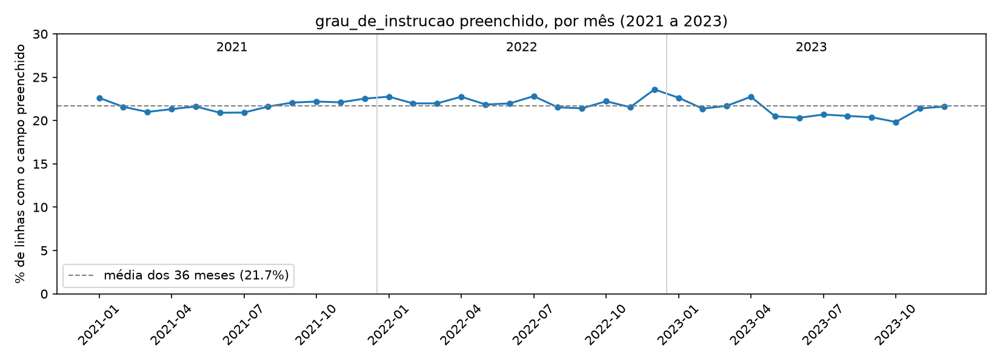

# Comparativo entre anos: 2021 × 2022 × 2023

> ETL-12. Compara os perfis das ETL-07, 08 e 09 (`perfil_2021.md`, `perfil_2022.md` e `perfil_2023.md`), os três `corrompidos_AAAA.csv` e três resumos gerados a partir do `01_bruto.parquet` e guardados em `docs/perfil/resumos/` (`valores_por_ano.csv`, `mensal.csv` e `por_dimensao.csv`). Nenhum dado foi alterado. Os cálculos estão em `notebooks/exploracao/comparativo_anos.ipynb`.

## Os três anos lado a lado

| | 2021 | 2022 | 2023 |
| --- | --- | --- | --- |
| Linhas | 260.886 | 266.128 | 279.963 |
| Sinistros distintos | 128.207 | 132.358 | 142.130 |
| Pessoas por sinistro (média) | 2,03 | 2,01 | 1,97 |
| Óbitos (% das linhas) | 4.858 (1,86%) | 5.445 (2,05%) | 5.490 (1,96%) |
| `grau_de_instrucao` nulo | 78,29% | 77,82% | 78,91% |
| `profissao` nula | 10,32% | 9,32% | 12,20% |
| `nacionalidade` nula | 11,94% | 10,44% | 13,13% |
| `idade` nula | 1,33% | 1,43% | 0,40% |
| `local_via` = NAO DISPONIVEL | 7,99% | 8,04% | 26,81% |
| `sexo` = NAO DISPONIVEL | 1,34% | 0,11% | 0,21% |
| Valores distintos de `profissao` | 515 | 588 | 658 |
| Valores distintos de `profissao` após normalizar* | 504 | 482 | 485 |
| Valores distintos de `nacionalidade` | 65 | 68 | 74 |
| Valores distintos de `municipio` | 644 | 642 | 645 |

\* Normalizar aqui é só passar para maiúsculas, tirar acentos e pontuação e deixar espaços únicos.

## Os 5 achados

### 1. A estrutura é a mesma nos três anos; só o volume cresce

- As 31 colunas da fonte (mais `arquivo_origem`) aparecem na mesma ordem nos três anos, sem colunas novas ou ausentes.
- As linhas passam de 260.886 para 266.128 (+2,0%) e 279.963 (+5,2%). O total, 806.977, confere com a extração (ETL-05). Os sinistros crescem mais que as linhas (+3,2% e +7,4%), e por isso a média de pessoas por sinistro cai de 2,03 para 1,97.
- Os óbitos somam 15.793 (confere com o plano), e em cada ano são iguais ao número de linhas com `gravidade_lesao` = FATAL. As 7 colunas de óbito são nulas nas mesmas linhas nos três anos.
- Em cada ano, `id_pessoa` é único, não há linhas 100% idênticas e nenhuma linha tem o mês de `data_sinistro` diferente do mês do arquivo.

**O que muda no pipeline:** um único conjunto de regras serve aos 36 meses. A unicidade de `id_pessoa` foi checada só dentro de cada ano; a ETL-13 precisa conferir se há repetição entre anos.

### 2. Nenhuma categoria relevante surgiu ou sumiu; o aumento de valores de `profissao` é de caixa mista

- **Colunas de domínio:** nas seis colunas de domínio (`gravidade_lesao`, `tipo_de_vitima`, `sexo`, `tipo_via`, `tipo_veiculo_vitima`, `regiao_administrativa`), o conjunto de valores é idêntico nos três anos. Só as proporções mudam.
- **`municipio`:** a união dos três anos tem os 645 municípios do Estado. Os que faltam em algum ano são pequenos e quase sem registros: `ARAPEI` (2 linhas, só em 2023), `RIBEIRAO DOS INDIOS` (8 em 2021, nenhuma em 2022, 2 em 2023) e `URU` (5, nenhuma, 2). Não é falha de cobertura: nesses anos não houve registro.
- **`nacionalidade`:** a união tem 90 valores, e só 52 aparecem nos três anos. Os outros 38 têm de 1 a 4 linhas por ano; é a cauda de nacionalidades raras, e não mudança da base. Algumas grafias parecem erro de acentuação (`FÍLIPINO`, `NÍGÉRIO`, `KUWAÍTÍANO`), e há `BRASILEIRO` (2 linhas em 2022, 1 em 2023) ao lado de `BRASILEIRA`.
- **`profissao`:** os valores distintos sobem de 515 para 588 e 658, mas isso vem de grafia, não de profissões novas. A partir de 2022 aparecem valores em caixa mista (`Aposentado(a)`, `Motorista`) ao lado dos em maiúsculas (`APOSENTADO(A)`, `MOTORISTA`): 9 valores e 9 linhas em 2021, 106 valores e 448 linhas (0,19%) em 2022, 258 valores e 2.577 linhas (1,05%) em 2023. Depois de normalizar, o número de valores fica estável (504, 482 e 485). As profissões que surgem ou somem de verdade são poucas e raras: 34 surgiram e 56 sumiram de 2021 para 2022, e 51 e 48 de 2022 para 2023, nunca mais que 85 linhas no conjunto. Os valores com acento (como `SEGURANÇA` ao lado de `SEGURANCA`) estão nos três anos, em cerca de 2,2% das linhas com `profissao` preenchida.
- As 814 grafias de `profissao` na união dos anos viram 568 depois da normalização simples; 243 profissões aparecem com mais de uma grafia.

**O que muda no pipeline:** a `dim_localidade` (ETL-21) pode ser construída com os 645 municípios. A `dim_profissao` (ETL-22) e a ETL-17 precisam passar tudo para maiúsculas e sem acento antes de agrupar, senão cada profissão em caixa mista vira uma linha nova na dimensão. As 568 são um teto: a normalização simples não unifica `MOTO-BOY` e `MOTOBOY`, que a ETL-17 trata.

### 3. `grau_de_instrucao` não muda ao longo dos 36 meses, e o nulo depende do tipo de vítima

- **Mês a mês:** o campo é preenchido em cerca de 22% das linhas em todos os meses, de 19,83% (out/2023) a 23,59% (dez/2022). O nulo anual é de 78,29%, 77,82% e 78,91%. Janeiro de 2021, que o plano citava como mês preenchido, tem 22,62%, só o 7º maior entre os 36 meses. A sequência mais longa abaixo de 21% é de mai a out/2023 (19,83% a 20,69%).
- **Por tipo de vítima:** o preenchimento é quase o mesmo nos três anos e muito diferente entre os tipos. Pedestres: 82,2%, 82,6% e 82,8%. Passageiros: 35,5%, 34,9% e 34,8%. Condutores: 1,2%, 1,3% e 1,2%. Vítimas `NAO DISPONIVEL`: 32,9%, 37,1% e 28,8%.
- Os condutores são 46% a 47% das linhas e respondem por só 2,6% a 2,8% dos valores preenchidos (1.459 de 56.630 em 2021). Os preenchidos são, na prática, pedestres, passageiros e vítimas sem tipo.

**O que muda no pipeline:** não existe período confiável, e a ETL-16 não deve decidir por mês. O que explica o nulo é o tipo de vítima, e não o mês: o campo é quase sempre vazio para condutores, o que favorece tratá-lo como nulo estrutural e não como falta aleatória (o rótulo, `NÃO SE APLICA` ou `NÃO INFORMADO`, é decisão da ETL-16). Qualquer análise por escolaridade vale só para as linhas preenchidas, que não representam a base.

### 4. `NAO DISPONIVEL` e nulos mudam em datas precisas, e não de forma gradual

- **`local_via` salta em mai/2023.** De jan/2021 a mar/2023 o `NAO DISPONIVEL` fica entre 7,6% e 9,3% (exceto dez/2022, com 4,9%). Em abr/2023 sobe para 11,4%, em mai/2023 para 32,6%, e de mai a dez/2023 fica entre 25,0% e 38,5%. Em 2023 são 75.067 linhas, 53.678 a mais que em 2022.
- **O salto é geral, mas está nas vias urbanas.** Acontece nas 16 regiões (de +3,4 pontos em Registro a +32,4 em Araçatuba, que passa a 45,0%, e Presidente Prudente a 43,9%) e em todos os tipos de vítima (condutor de 4,9% para 19,8%, passageiro de 3,8% para 23,0%, pedestre de 3,5% para 24,9%). Em vias urbanas o `NAO DISPONIVEL` vai de 18.655 para 70.014 linhas (de 8,5% para 30,1%), o que responde por 96% do aumento. Em estradas e rodovias vai de 5,6% para 10,4%.
- **`sexo` cai em jan/2022.** O `NAO DISPONIVEL` passa de 1,39% em dez/2021 (320 linhas) para 0,06% em jan/2022 (11 linhas). Em 2021, 74% deles estavam em vias urbanas (2.583 de 3.487); em 2022 e 2023, 92% e 96% estão em estradas e rodovias (267 de 289 e 564 de 590).
- **Registros incompletos andam juntos.** Quando `tipo_de_vitima` é `NAO DISPONIVEL`, `local_via` também é com muito mais frequência (30,8%, 33,8% e 57,4%, contra 3,5% a 4,9% nos demais tipos em 2021 e 2022).
- **Variações menores em 2023** (dos perfis, sem detalhe por mês): os nulos de `profissao` (12,20%) e de `nacionalidade` (13,13%) sobem cerca de 2,9 e 2,7 pontos em relação a 2022, e os de `idade` caem de 1,43% para 0,40%.
- **Estáveis nos três anos:** o bloco de veículo (`id_veiculo`, `tipo_veiculo_vitima`, `modo_transporte_vitima`, entre 19,5% e 21,8% de nulos) e as colunas de óbito (cerca de 98%).

**O que muda no pipeline:** na ETL-16, `NAO DISPONIVEL` e nulo precisam ser unificados em `NÃO INFORMADO` coluna a coluna. O `local_via` de mai/2023 em diante não é comparável com o período anterior (afeta `dim_via`, ETL-21): análises por local da via devem separar antes e depois de mai/2023 ou tratar o período como informação incompleta.

### 5. O texto tem os mesmos defeitos nos três anos

- Os três `corrompidos_AAAA.csv` têm exatamente os mesmos 8 valores, todos em `municipio`: 7 com "D OESTE" (como `SANTA BARBARA D OESTE`) e `SAO JOAO DO PAU D ALHO`. É o apóstrofo que virou espaço; só a ordem das linhas muda entre os arquivos.
- Nenhum ano tem caractere inválido ou acento mal lido. Os arquivos não são UTF-8 e foram lidos como `latin-1`, com os acentos corretos.
- `nacionalidade` tem espaços no fim em **todos** os valores distintos, nos três anos (65, 68 e 74 valores; 229.731, 238.353 e 243.207 linhas).
- A inconsistência de caixa de `profissao` (achado 2) não aparece nos `corrompidos`, porque o critério deles busca letras isoladas e acentos mal lidos.

**O que muda no pipeline:** na ETL-14, um único mapa `{valor errado: valor certo}` corrige os três anos, e basta `strip()` em `nacionalidade`. A caixa de `profissao` fica para a ETL-17.

## Limites desta comparação

**O que os resumos do `01_bruto.parquet` resolveram:** quais categorias surgiram ou sumiram (achado 2), em que mês o `local_via` e o `sexo` mudam e onde (achado 4) e como o `grau_de_instrucao` se distribui por tipo de vítima (achado 3).

**O que continua em aberto:**

- **A causa das mudanças.** Os dados mostram quando e onde, não por quê. Três mudanças têm data: `sexo` em jan/2022, a caixa mista de `profissao` entre 2022 e 2023 e `local_via` em mai/2023. Que sejam mudanças de sistema ou de formulário de registro é hipótese, e só a documentação da fonte (ou o órgão que publica) pode confirmar.
- **Quando começa a caixa mista de `profissao`.** O resumo por ano só mostra que ela cresce de 2022 para 2023. Para achar o mês, falta o % de linhas em caixa mista por mês.
- **O aumento dos nulos de `profissao` e `nacionalidade` em 2023** (+2,9 e +2,7 pontos). Vem dos perfis e não foi aberto por mês, região ou tipo de vítima.
- **Por que condutores quase não têm `grau_de_instrucao`.** O padrão é claro e estável nos três anos, mas a razão (se o campo não é coletado para condutores) depende da documentação da fonte.
- **Repetição de `id_pessoa` entre anos.** Foi checada só dentro de cada ano. A ETL-13 precisa conferir a base inteira.
- **A normalização de `profissao`** usada aqui é simples. O número de 568 profissões é um teto, e a ETL-17 vai definir os grupos finais.
- **Os dados de apoio.** Os números vêm dos três perfis e dos três resumos do `01_bruto.parquet`. Como os resumos são derivados da extração, só valem se o `.parquet` for o completo (806.977 linhas, que confere com a soma dos meses).