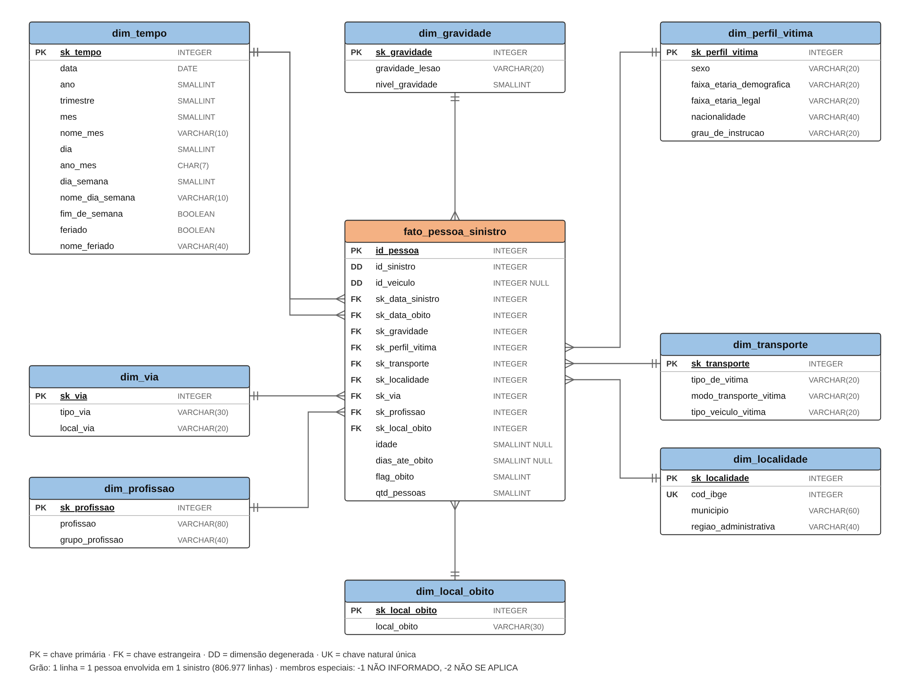
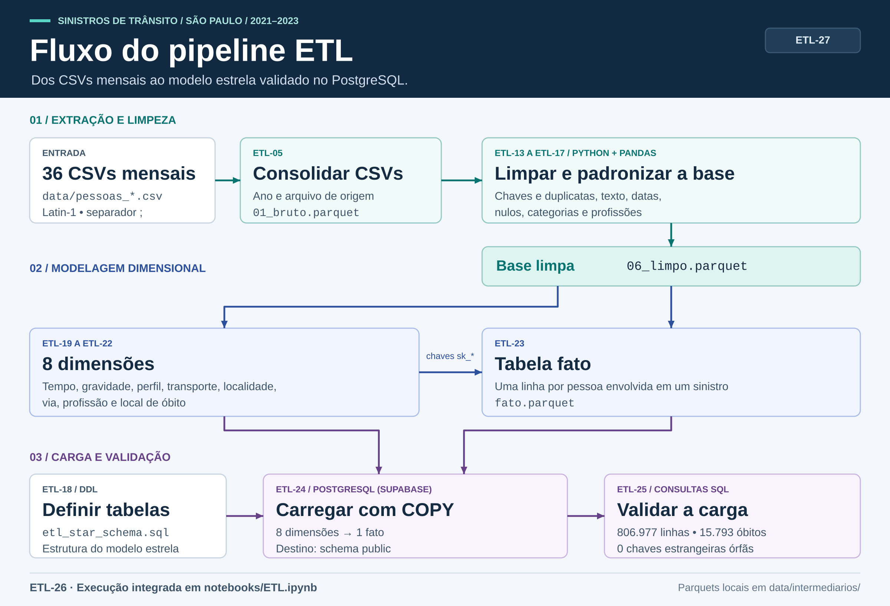

# 1. Descrição da Modelagem Dimensional (Esquema Estrela) e Dicionário de Dados

*Figura 1. Modelo estrela do data warehouse.*

## Modelo estrela do Data Warehouse (ETL-10)

**O que foi feito:** a modelagem dimensional do DW, com 1 tabela fato e 8 dimensões. O diagrama está em `docs/modelagem/modelo_estrela.png` (fonte editável em `.drawio`) e a especificação completa, coluna por coluna, em `docs/modelagem/modelo_estrela.md`.

**Grão:** uma linha da fato `fato_pessoa_sinistro` é uma pessoa envolvida em um sinistro. A fonte já vem nesse grão: `id_pessoa` é único nas 806.977 linhas, e esse é o número de linhas que a fato deve ter depois da carga.

**Tabelas:**
- **Fato:** `fato_pessoa_sinistro`, com 9 chaves estrangeiras, 3 dimensões degeneradas (`id_pessoa`, `id_sinistro`, `id_veiculo`) e as medidas `qtd_pessoas`, `flag_obito`, `idade` e `dias_ate_obito`.
- **Dimensões:**
  - `dim_tempo`, usada duas vezes: data do sinistro e data do óbito, de 01/01/2021 a 24/01/2024;
  - `dim_gravidade`;
  - `dim_perfil_vitima`;
  - `dim_transporte`;
  - `dim_localidade`, com 645 municípios e 16 regiões;
  - `dim_via`;
  - `dim_profissao`;
  - `dim_local_obito`.

**Destino das 31 colunas da fonte:** 23 são aproveitadas e 8 são descartadas. As descartadas são ano, mês, dia e ano_mes do sinistro e do óbito, porque derivam das datas e já estão na `dim_tempo`. Nos dados brutos, conferimos que elas batem 100% com as datas, e também que `tempo_sinistro_obito` é exatamente a diferença em dias entre óbito e sinistro (15.793 óbitos).

**Decisões principais:**
1. **Grão por pessoa:** as perguntas do projeto são sobre quem se envolve e quem morre.
2. **Dimensões de combinações** (perfil, transporte, via): reduzem a fato de 16 para 9 chaves estrangeiras, com cerca de 1.500, 27 e 11 linhas.
3. **`idade` na fato e não na dimensão:** colocar idade na dimensão faria as combinações explodirem.
4. **Membros especiais:** `-1` (NÃO INFORMADO) e `-2` (NÃO SE APLICA), para a fato nunca ter chave estrangeira nula.

## Dicionário de dados da fonte (ETL-11)

**O que foi feito:** levantamento e documentação completa das **31 colunas originais** presentes nos 36 arquivos CSV mensais da fonte (*Pessoas Envolvidas em Sinistros — Dados Abertos SP*, 2021 a 2023), além das **2 colunas de rastreio** previstas para criação na extração (`ano_origem` e `arquivo_origem`), no arquivo `docs/dicionario/dicionario_fonte.md`.

**Por quê:** estabelecer uma referência única sobre o significado, o formato bruto, o domínio, a completude e o papel analítico de cada campo antes das transformações de limpeza e da construção do esquema estrela (alimenta a Seção 1 do relatório final e serve de base para o dicionário do Data Warehouse na ETL-18).

**Nota de processo (retrabalho por dependência pendente):** a ETL-11 depende da ETL-05 (`01_extracao.ipynb` / `01_bruto.parquet`), que ainda não havia sido entregue no repositório. Para não atrasar a documentação, foi necessário ler e consolidar diretamente os 36 CSVs brutos em `data/`, registrando `ano_origem` e `arquivo_origem` como colunas previstas na ETL-05.

**Resultados:**
- **Consistência estrutural:** os 36 arquivos (`pessoas_MM-AAAA.csv`, separador `;`, encoding `latin-1`) possuem exatamente as mesmas 31 colunas na mesma ordem, somando **806.977 linhas** (2021: 260.886; 2022: 266.128; 2023: 279.963) e **402.695 sinistros distintos**, com `id_pessoa` 100% único.
- **Classificação para o DW (alinhada à ETL-10):** das 31 colunas da fonte, **3** são identificadores/dimensões degeneradas (`id_sinistro`, `id_pessoa`, `id_veiculo`) na `fato_pessoa_sinistro` (que também recebe a medida `qtd_pessoas`), **16** compõem as 7 dimensões descritivas, **2** são datas de evento (`data_sinistro`, `data_obito`) ligadas à `dim_tempo`, **2** são medidas numéricas (`idade`, `tempo_sinistro_obito`) e **8** são colunas temporais derivadas e redundantes (marcadas para descarte na ETL-15).
- **Mapeamento de qualidade:** documentados os nulos reais (destaque para o bloco de óbito com 98,04% de nulos sempre nas mesmas linhas, `grau_de_instrucao` com 78,35% e o bloco de veículo em ~21%), os nulos disfarçados como `"NAO DISPONIVEL"` (até 14,54% em `local_via` e 13,98% em `tipo_de_vitima`), as variações de nulo disfarçado em `profissao` (`NAO INFORMADA`, `NÃO INFORMADO`, `Nao informada` e `Sem profissao definida`, somando 943 linhas / 0,12%) e os problemas de texto (`nacionalidade` com espaços à direita em 711.291 linhas e 8 municípios com apóstrofo substituído por espaço), vinculando cada coluna à sua tarefa de tratamento (`ETL-13` a `ETL-23`).

**Entregável completo:** `docs/dicionario/dicionario_fonte.md`.

## DDL do esquema estrela e dicionário do DW (ETL-18)

**O que foi feito:** criação do script DDL [`sql/ddl/etl_star_schema.sql`](../../sql/ddl/etl_star_schema.sql) para o esquema estrela no PostgreSQL (Supabase), execução idempotente no banco em nuvem e elaboração do dicionário físico e lógico do Data Warehouse em [`docs/dicionario/dicionario_dw.md`](../dicionario/dicionario_dw.md).

**Por quê:** materializar no banco a modelagem definida na ETL-10 (`modelo_estrela.md`) com integridade referencial, restrições de domínio e metadados no catálogo antes da carga dos dados (ETL-24), além de documentar todas as tabelas, colunas, tipos físicos e regras de linhagem para consulta na etapa de análise e no relatório final.

**Estrutura criada e validada no PostgreSQL (Supabase):**
- **9 tabelas (54 colunas no total):** `fato_pessoa_sinistro` (16 colunas) + 8 dimensões (`dim_tempo` com 13, `dim_perfil_vitima` com 6, `dim_transporte` com 4, `dim_localidade` com 4, `dim_gravidade` com 3, `dim_via` com 3, `dim_profissao` com 3 e `dim_local_obito` com 2).
- **Integridade e restrições:** 9 chaves primárias (`PK`), 9 chaves estrangeiras `NOT NULL` ligando a fato às dimensões (com *role-playing* de `dim_tempo` em `sk_data_sinistro` e `sk_data_obito`), 8 restrições `UNIQUE` nas chaves naturais ou combinações de dimensão, e 21 restrições `CHECK` (cobrindo faixas de `idade` 0–120, `dias_ate_obito` 0–30, `flag_obito` ∈ {0, 1}, `qtd_pessoas = 1`, coerência entre `flag_obito` e colunas de óbito, e obrigatoriedade de atributos reais quando `sk > 0`).
- **Índices e catálogo:** 10 índices explícitos na tabela fato (`idx_fato_id_sinistro` e 1 índice por FK) e `COMMENT ON TABLE`/`COMMENT ON COLUMN` gravados nas 9 tabelas e nas 54 colunas do schema `public`.
- **Idempotência e teste de carga:** bloco inicial `DROP TABLE IF EXISTS ... CASCADE` testado em execuções sucessivas via SQLAlchemy/PostgreSQL (`exec_driver_sql`, `text()` em `AUTOCOMMIT` e transação `engine.begin()`), além de *smoke test* transacional (com *rollback*) validando a inserção dos membros especiais `-1` (`NÃO INFORMADO`) e `-2` (`NÃO SE APLICA`) junto a registros de exemplo com e sem óbito.

**Ajustes preventivos em relação à especificação lógica (`ETL-10`):**
- Ampliação de `dim_tempo.nome_mes` e `dim_tempo.nome_dia_semana` para `VARCHAR(20)` e de `dim_tempo.ano_mes` para `VARCHAR(15)` (comportando `'SEGUNDA-FEIRA'`, `'NÃO INFORMADO'` e `'NÃO SE APLICA'`, todos com 13 caracteres).
- Nulabilidade condicional nos atributos não textuais dos membros especiais `-1` e `-2` em `dim_tempo`, `dim_gravidade.nivel_gravidade` e `dim_localidade.cod_ibge`, protegida por `CHECK` para `sk > 0`.

**Entregáveis:** [`sql/ddl/etl_star_schema.sql`](../../sql/ddl/etl_star_schema.sql) e [`docs/dicionario/dicionario_dw.md`](../dicionario/dicionario_dw.md).

# 2. Processo de integração, da coleta à carga

*Figura 2. Fluxo da ETL, da extração à carga.*

## Extração dos 36 CSVs (ETL-05)

**O que foi feito:** leitura dos 36 arquivos mensais (2021 a 2023) e junção em uma única tabela de 806.977 linhas. Nenhum dado foi alterado. O resultado foi salvo em `data/intermediarios/01_bruto.parquet`.

**Por quê:** as etapas seguintes leem essa tabela, em vez de abrir os 36 CSVs de novo. O parquet ocupa menos espaço e carrega mais rápido.

**O que foi conferido:**
- os 36 arquivos têm as mesmas 31 colunas, na mesma ordem
- o total é de 806.977 linhas

**O que foi acrescentado:** `ano_origem` e `arquivo_origem`, para saber de qual arquivo cada linha veio. A tabela final tem 33 colunas.

**Observação:** o `.parquet` não vai para o Git. Quem precisar dele roda este notebook.

## dim_tempo e dim_gravidade (ETL-19)

**O que foi feito:** criação da `dim_tempo` e da `dim_gravidade` no notebook `notebooks/etl/07a_dim_tempo_gravidade.ipynb`, com as colunas do DDL da ETL-18 e os membros especiais -1 (NÃO INFORMADO) e -2 (NÃO SE APLICA). Os arquivos foram salvos em `data/intermediarios/dims/`. A tarefa era do Samuel e foi assumida pelo Davi.

**Entradas:** as datas vêm da saída da ETL-15 e a `gravidade_lesao` vem da saída da ETL-16, que deixou o `NAO DISPONIVEL` dessa coluna para esta etapa.

**Resultado:**
- `dim_tempo`: 1.121 linhas, sendo 1.119 dias (de 01/01/2021 a 24/01/2024, a maior data de óbito) e os 2 membros especiais. A chave é a data no formato `AAAAMMDD`. A tabela tem trimestre, nome do mês, `ano_mes`, dia da semana (1 = segunda ... 7 = domingo), fim de semana e feriado.
- `dim_gravidade`: 6 linhas, sendo ILESO, LEVE, GRAVE e FATAL, com `nivel_gravidade` de 0 a 3, e os 2 membros especiais.

**Feriados:** entram só os nacionais, como proposto no modelo estrela. São 28 no período: 9 por ano de 2021 a 2023 e 1 em janeiro de 2024. Os 9 de cada ano são os 8 de data fixa e a Sexta-feira Santa, calculada a partir da Páscoa. Ficam de fora:
- Carnaval e Corpus Christi, que são ponto facultativo;
- os feriados estaduais de SP;
- o Dia da Consciência Negra, que só virou feriado nacional em 2024.

**Membros especiais:**
- O `NAO DISPONIVEL` da gravidade vai para o -1 (70.314 pessoas, 8,71%).
- Na data do óbito, o -2 é exatamente quem não morreu (791.184 pessoas).
- Na `dim_tempo`, os membros especiais têm data e números nulos, e os textos recebem o rótulo, como permite o DDL.

**Como foi validado:**
- o calendário não tem buracos e as chaves são únicas;
- os textos cabem nos tamanhos do DDL;
- os dias reais têm todos os campos obrigatórios da regra `chk_dim_tempo_campos_validos`;
- as 806.977 pessoas acham chave nas duas datas e na gravidade;
- a gravidade FATAL coincide com os 15.793 óbitos;
- o notebook rodou com pandas 3 e 2.3.3 sem avisos.

**Achado:** nos feriados há menos pessoas envolvidas por dia (642) do que nos dias úteis (730) e nos fins de semana (763).

## dim_perfil_vitima e dim_transporte (ETL-20)

**O que foi feito:** criação das duas dimensões de combinações do modelo estrela, a partir da saída da ETL-16. Cada uma tem uma linha por combinação que existe nos dados, uma chave substituta `sk_` e os membros especiais -1 (NÃO INFORMADO) e -2 (NÃO SE APLICA). Os arquivos foram salvos em `data/intermediarios/dims/`.

**Resultado:**
- `dim_transporte`: 25 linhas (23 combinações de tipo de vítima, modo de transporte e tipo de veículo)
- `dim_perfil_vitima`: 1.500 linhas (1.498 combinações de sexo, faixas etárias, nacionalidade e grau de instrução)

**O que foi conferido:** as chaves são únicas, nenhuma combinação se repete e as 806.977 pessoas encontram uma chave nas duas dimensões.

**Observação:** combinações em que todas as colunas são NÃO INFORMADO não viram linha própria, elas usam o membro -1. A idade exata fica na tabela fato, como no modelo.

**Observação 2:** `nacionalidade` ainda pode ter espaços no fim do texto, que são tratados na ETL-14. Quando essa etapa entrar, o número de combinações pode diminuir um pouco.

## dim_localidade e dim_via (ETL-21)

**O que foi feito:** criação das dimensões `dim_localidade` e `dim_via` do modelo estrela no notebook [`notebooks/etl/07c_dim_localidade_via.ipynb`](../../notebooks/etl/07c_dim_localidade_via.ipynb). Ambas possuem chave substituta `sk_*` sequencial a partir de `1`, ordenação determinística e os membros especiais `-1` (`NÃO INFORMADO`) e `-2` (`NÃO SE APLICA`). Os arquivos foram salvos em `data/intermediarios/dims/`.

**Entradas:** para refletir as limpezas já consolidadas nas etapas anteriores, `dim_localidade` lê `data/intermediarios/03_texto.parquet` (saída da `ETL-14`, com apóstrofos `D'OESTE` / `D'ALHO` e espaços normalizados) e `dim_via` lê `data/intermediarios/05_nulos_categorias.parquet` (saída da `ETL-16`, com nulos e `NAO DISPONIVEL` padronizados para `NÃO INFORMADO`). Na execução encadeada final (`ETL-26`), ambas passam a apontar para `06_limpo.parquet`.

**Resultado:**
- `dim_localidade`: **647 linhas**, sendo **645 municípios** paulistas ordenados por `cod_ibge` crescente (`3500105` a `3557303`, distribuídos em 16 regiões administrativas) e os **2 membros especiais** (`-1` e `-2` com `cod_ibge` nulo em `Int64`, compatível com o DDL em [`sql/ddl/etl_star_schema.sql`](../../sql/ddl/etl_star_schema.sql)).
- `dim_via`: **10 linhas**, sendo **8 combinações reais** de `(tipo_via, local_via)` ordenadas alfabeticamente e os **2 membros especiais** (`-1` e `-2`).

**Tratamento de `('NÃO INFORMADO', 'NÃO INFORMADO')` em `dim_via`:** das 9 combinações presentes na base tratada pela `ETL-16`, a combinação dupla `('NÃO INFORMADO', 'NÃO INFORMADO')` (**663 pessoas**) não recebe chave positiva própria e passa a apontar diretamente para o membro **`-1`**, respeitando a restrição `UNIQUE (tipo_via, local_via)` do PostgreSQL. As combinações parciais em que apenas um atributo é conhecido (ex.: `VIAS URBANAS` + `NÃO INFORMADO`, com 107.156 pessoas; `ESTRADAS E RODOVIAS` + `NÃO INFORMADO`, com 19.757; `NÃO INFORMADO` + `PUBLICO`, com 303; `NÃO INFORMADO` + `PRIVADO`, com 7) permanecem com `sk_via > 0`. Por essa razão, a tabela final tem **10 linhas** (frente à estimativa inicial de ~11 linhas no modelo lógico).

**Como foi validado:**
- alinhamento de `id_pessoa` entre as duas entradas (`806.977` pessoas);
- relação 1:1 confirmada entre `cod_ibge` e `municipio`, e 1 única `regiao_administrativa` por município;
- ausência de municípios com `D OESTE` / `D ALHO` sem apóstrofo e ausência de `NaN` ou `NAO DISPONIVEL` em `tipo_via` e `local_via`;
- chaves `sk_localidade` e `sk_via` únicas e sequenciais, zero duplicatas nas chaves naturais e comprimentos dentro dos limites `VARCHAR` do DDL;
- cobertura de **100%** na base: todas as `806.977` pessoas recebem chave válida (`0` sem chave; em `dim_localidade`, todas usam `sk > 0`; em `dim_via`, `806.314` usam `sk > 0` e `663` usam `-1`).

**Para a ETL-23 (tabela fato):** o notebook disponibiliza as funções `atribuir_sk_localidade` e `atribuir_sk_via`, que mapeiam cada registro da base limpa para as respectivas chaves substitutas.

## dim_profissao e dim_local_obito (ETL-22)

**O que foi feito:** criação das duas últimas dimensões descritivas do modelo estrela, `dim_profissao` e `dim_local_obito`, no notebook `notebooks/etl/07d_dim_profissao_local_obito.ipynb`. Cada uma tem chave substituta `sk_` e os membros especiais -1 (NÃO INFORMADO) e -2 (NÃO SE APLICA). Os arquivos foram salvos em `data/intermediarios/dims/`.

**Entradas:** a profissão e o `grupo_profissao` vêm da saída da ETL-17, e o local do óbito vem da saída da ETL-16.

**Resultado:**
- `dim_profissao`: 561 linhas, sendo 559 profissões padronizadas (cada uma com seu `grupo_profissao`, em 12 grupos) e os 2 membros especiais.
- `dim_local_obito`: 5 linhas, sendo 3 locais (estabelecimento de saúde, via e outros) e os 2 membros especiais.

**Nulos escondidos na profissão:** as grafias `NAO INFORMADA` (636 pessoas) e `NAO INFORMADO` (298) são "não informado" escrito como se fosse profissão, e a ETL-17 as deixou no grupo `OUTROS`. Elas passam a usar o membro -1, que reúne 86.834 pessoas: 85.900 com o campo vazio e 934 com essas grafias. `SEM PROFISSAO DEFINIDA` (9 pessoas) é uma resposta e continua como profissão.

**Local do óbito:** 791.184 pessoas usam o -2 (não morreram) e 105 usam o -1 (morreram, sem local informado). Os 15.793 óbitos se dividem em 7.940 em estabelecimento de saúde, 7.214 na via e 534 em outros locais.

**Como foi validado:**
- as chaves são únicas e nenhum nome se repete;
- cada profissão tem um grupo só;
- as 806.977 pessoas encontram uma chave nas duas dimensões;
- `NÃO SE APLICA` no local do óbito é exatamente quem não morreu;
- o notebook rodou com pandas 3.0.5 e 2.3.3, com os mesmos resultados.

**Limitação conhecida:** o membro -2 da `dim_profissao` não é usado, porque todas as pessoas têm profissão ou "não informada". Ele existe só para seguir a regra do modelo de que toda dimensão tem os dois membros.

**Para a ETL-23:** o notebook traz as funções `atribuir_sk_profissao` e `atribuir_sk_local_obito`, que ligam cada pessoa à sua chave. Se a ETL-17 passar a tratar `NAO INFORMADA` e `NAO INFORMADO` como nulo, esta etapa continua valendo sem mudar.

## Tabela fato (ETL-23)

**O que foi feito:** montagem da `fato_pessoa_sinistro` no notebook `notebooks/etl/08_fato.ipynb`, com uma linha por pessoa envolvida em um sinistro. As 23 colunas aproveitadas da fonte viraram:
- 3 identificadores: `id_pessoa`, `id_sinistro` e `id_veiculo`;
- 9 chaves para as 8 dimensões, sendo duas para a `dim_tempo` (data do sinistro e data do óbito);
- 4 medidas: `idade`, `dias_ate_obito`, `flag_obito` e `qtd_pessoas`.

A saída foi salva em `data/intermediarios/fato.parquet`, com 806.977 linhas e 16 colunas, na ordem do DDL da ETL-18.

**Entradas:** cada grupo de colunas vem do mesmo arquivo que gerou a sua dimensão (saídas das ETL-13 a ETL-17) e é juntado pelo `id_pessoa`. Na execução final (ETL-26), todos apontam para o mesmo arquivo.

**Como foi validado:**
- **Totais:** 806.977 pessoas, 402.695 sinistros e 15.793 óbitos, iguais aos da base limpa. Por ano, são 260.886, 266.128 e 279.963 pessoas, iguais aos da fonte.
- **Chaves:** as 9 chaves existem nas suas dimensões e nenhuma é nula. As funções de busca param com erro se alguma pessoa não achar chave, em vez de mandar um valor inesperado para o -1.
- **Regras do DDL:** todas as `CHECK` da tabela valem, inclusive a coerência do óbito: quem não morreu tem data e local do óbito -2 e `dias_ate_obito` nulo.
- **Medidas:** `dias_ate_obito` é igual à diferença entre as duas datas nos 15.793 óbitos.
- **Ida e volta:** ligando a fato às dimensões, cada pessoa recupera exatamente os valores da base limpa nas 16 colunas comparadas (gravidade, perfil, transporte, via, município, profissão, local do óbito e datas).
- **Compatibilidade:** o notebook rodou com pandas 3 e 2.3.3 sem avisos.

**Membros especiais na fato:**

| Chave | -1 (NÃO INFORMADO) | -2 (NÃO SE APLICA) |
| --- | --- | --- |
| `sk_data_obito` | 0 | 791.184 |
| `sk_local_obito` | 105 | 791.184 |
| `sk_gravidade` | 70.314 | 0 |
| `sk_transporte` | 98.947 | 0 |
| `sk_profissao` | 86.834 | 0 |
| `sk_perfil_vitima` | 3.395 | 0 |
| `sk_via` | 663 | 0 |
| `sk_data_sinistro`, `sk_localidade` | 0 | 0 |

**Consulta de teste no esquema estrela:** a letalidade é maior nos feriados que nos fins de semana, e nos fins de semana maior que nos dias úteis.

| Tipo de dia | Pessoas | Óbitos | Letalidade |
| --- | --- | --- | --- |
| Dia útil | 554.750 | 9.243 | 1,67% |
| Fim de semana | 234.889 | 6.039 | 2,57% |
| Feriado | 17.338 | 511 | 2,95% |

**Próximo passo:** a ETL-24 carrega no PostgreSQL primeiro as 8 dimensões e depois a fato, por causa das chaves estrangeiras.

## Carga no PostgreSQL (ETL-24)

**O que foi feito:** criação das 9 tabelas do modelo estrela no PostgreSQL (Supabase) pelo DDL da ETL-18 e carga das 8 dimensões e da fato.

**Como foi carregado:** `COPY` em lotes de 100 mil linhas, a partir dos parquets. As dimensões entram primeiro e a fato por último, porque ela aponta para as chaves delas.

**Rodar mais de uma vez:** o DDL começa apagando e recriando as tabelas, então cada execução carrega do zero e não duplica nada.

**Resultado:**

| Tabela | Linhas |
|---|---|
| dim_tempo | 1.121 |
| dim_gravidade | 6 |
| dim_perfil_vitima | 1.500 |
| dim_transporte | 25 |
| dim_localidade | 647 |
| dim_via | 10 |
| dim_profissao | 561 |
| dim_local_obito | 5 |
| fato_pessoa_sinistro | 806.977 |

**O que foi conferido:** a contagem de cada tabela no banco bate com a do parquet de origem.

**Observação:** colunas que vinham como float com valores inteiros (por exemplo 12.0) são convertidas antes da carga, senão o banco recusa. A senha do banco fica só no `.env`, que não vai para o Git.

## Validação pós-carga (ETL-25)

Depois da carga no PostgreSQL (ETL-24), o banco foi conferido com consultas SQL rodadas pelo notebook `notebooks/etl/10_validacao.ipynb`. As consultas ficam salvas em `sql/validacao/etl_checks.sql` e podem ser rodadas de novo a qualquer momento.

### Contagem de linhas

| Tabela | Linhas |
|---|---|
| dim_tempo | 1.121 |
| dim_gravidade | 6 |
| dim_perfil_vitima | 1.500 |
| dim_transporte | 25 |
| dim_localidade | 647 |
| dim_via | 10 |
| dim_profissao | 561 |
| dim_local_obito | 5 |
| fato_pessoa_sinistro | 806.977 |

A fato tem o mesmo número de linhas da base tratada.

### Chaves estrangeiras

Para cada uma das 9 chaves da fato (a `dim_tempo` aparece duas vezes, na data do sinistro e na data do óbito) foi feito um `LEFT JOIN` procurando linhas sem correspondência na dimensão. O resultado foi 0 em todas, ou seja, nenhuma chave ficou órfã.

### Total de óbitos

A soma de `flag_obito` na fato é 15.793, o mesmo total da base original.

### Consultas de exemplo

Três consultas juntando a fato com as dimensões mostram que os relacionamentos funcionam:

- óbitos e vítimas por ano (2021: 4.858 óbitos; 2022: 5.445; 2023: 5.490);
- os 10 municípios com mais óbitos (São Paulo lidera, com 2.525);
- vítimas e óbitos por sexo e tipo de vítima.

### Arquivos

- Notebook: `notebooks/etl/10_validacao.ipynb`
- Consultas: `sql/validacao/etl_checks.sql`

## Notebook ETL completo, rodado do zero (ETL-26)

**O que foi feito:** criação do script [`scripts/montar_notebook_etl.py`](../../scripts/montar_notebook_etl.py), geração do notebook unificado [`notebooks/ETL.ipynb`](../../notebooks/ETL.ipynb) (266 células: 135 Markdown e 131 código) e execução integral do pipeline **do zero**, partindo apenas dos 36 CSVs brutos em `data/` (com `data/intermediarios/` previamente removida) até a carga completa e validação pós-carga no PostgreSQL (Supabase).

**Por quê:** consolidar em um único entregável reproduzível todas as etapas desenvolvidas de forma modular entre a ETL-05 e a ETL-25, garantindo que cada transformação e dimensão consuma a saída real da etapa anterior e que o banco final reflita exatamente o encadeamento completo.

**Decisões de implementação e encadeamento:**
- **Preservação dos notebooks individuais:** em conformidade com o [`CONTRIBUTING.md`](../../CONTRIBUTING.md) (*"ninguém edita o notebook de outro"*), os 13 notebooks em `notebooks/etl/` foram mantidos intactos como arquivos de trabalho; o script `scripts/montar_notebook_etl.py` aplica o encadeamento de forma determinística (com verificação exata de cada substituição) ao montar `notebooks/ETL.ipynb`.
- **Setup global unificado:** imports compartilhados, localização da raiz do repositório (`RAIZ`), caminhos (`DADOS`, `INTERM`, `DIMS`), carregamento de `src/conexao.py` e `src/perfil.py` e a função `diagnostico()` foram centralizados no início do notebook, mantendo nas etapas apenas suas constantes e lógicas específicas.
- **Encadeamento das entradas (`01` → `10`):**
  - `03_texto_encoding` passou a ler `02_chaves_duplicatas.parquet` (em vez de `01_bruto.parquet`);
  - `04_datas` passou a ler `03_texto.parquet`;
  - `05_nulos_categorias` passou a ler `04_datas.parquet` (substituindo a leitura direta dos 36 CSVs) e recebeu dois ajustes de compatibilidade com as colunas já removidas na ETL-15: `converter_inteiros` filtra apenas as colunas presentes (`idade`, `id_veiculo`), e o acompanhamento mensal de `grau_de_instrucao` deriva `AAAA-MM` de `data_sinistro` na ausência de `ano_mes_sinistro`;
  - `06_profissao` passou a ler `05_nulos_categorias.parquet` e passou a classificar `'NAO INFORMADO'` (resultante da normalização sem acento sobre nulos preenchidos na ETL-16) no grupo `'NÃO INFORMADO'` em `grupo_profissao`;
  - As etapas de dimensões (`07a`, `07b`, `07c`, `07d`) e a montagem da tabela fato (`08_fato`) passaram a apontar todas as suas fontes para `06_limpo.parquet`.

**Resultados da execução do zero:**
- **Execução sem erros:** todas as **266 células** executaram em sequência com **0 erros** e **0 avisos** (tempo total: **220,9 s**).
- **Integridade na camada limpa (`06_limpo.parquet`):** `806.977` linhas preservadas (`260.886` em 2021, `266.128` em 2022 e `279.963` em 2023), `402.695` sinistros distintos e `15.793` óbitos.
- **Dimensões, fato e carga no PostgreSQL (Supabase):** recriação idempotente via [`sql/ddl/etl_star_schema.sql`](../../sql/ddl/etl_star_schema.sql) e carga via `COPY` com conferência linha a linha:
  - `dim_tempo`: `1.121` linhas (`01/01/2021` a `24/01/2024` + membros `-1` e `-2`)
  - `dim_gravidade`: `6` linhas
  - `dim_perfil_vitima`: `1.500` linhas (com `nacionalidade` já sem espaços à direita)
  - `dim_transporte`: `25` linhas
  - `dim_localidade`: `647` linhas
  - `dim_via`: `10` linhas
  - `dim_profissao`: `561` linhas
  - `dim_local_obito`: `5` linhas
  - `fato_pessoa_sinistro`: `806.977` linhas × `16` colunas
- **Validação pós-carga:** `0` chaves estrangeiras órfãs nas 9 FKs da fato, `0` divergências na verificação de ida e volta nas 16 colunas comparadas contra `06_limpo.parquet`, `15.793` óbitos confirmados no banco (`4.858` em 2021, `5.445` em 2022 e `5.490` em 2023) e consultas de [`sql/validacao/etl_checks.sql`](../../sql/validacao/etl_checks.sql) reproduzidas integralmente.

**Entregáveis:** [`scripts/montar_notebook_etl.py`](../../scripts/montar_notebook_etl.py) e [`notebooks/ETL.ipynb`](../../notebooks/ETL.ipynb) (com todas as saídas salvas).

## Fluxo da ETL e guia de execução (ETL-27)

**Responsável:** Samuel de Almeida (`@safn007`). **Revisor previsto:** Pedro Wellington (`@PedroWellington`). **Dependência:** ETL-26.

### O que foi feito e por quê

O [diagrama editável](../diagramas/fluxo_etl.drawio) e a [versão em PNG](../diagramas/fluxo_etl.png) documentam a ordem em que a ETL recebe, transforma e carrega os dados. O [README](../../README.md) passou a indicar os arquivos de entrada, a configuração do ambiente, a execução do notebook final, os resultados de referência e as contribuições dos integrantes. O objetivo é que outra pessoa consiga entender e reproduzir a execução sem depender dos notebooks avulsos ou de Parquets já gerados.

### Como o fluxo funciona

1. **Extração (ETL-05).** Os 36 CSVs mensais são lidos, identificados pelo ano e pelo arquivo de origem e consolidados em `01_bruto.parquet`.
2. **Transformação (ETL-13 a ETL-17).** A sequência confere chaves e duplicatas, normaliza texto, converte datas, trata nulos e categorias e padroniza profissões. O produto comum dessas etapas é `06_limpo.parquet`.
3. **Modelo estrela (ETL-19 a ETL-23).** A base limpa alimenta as oito dimensões em `data/intermediarios/dims/`. A tabela fato combina essa mesma base com as oito dimensões e é gravada em `fato.parquet`. Cada linha da fato representa uma pessoa envolvida em um sinistro.
4. **Carga e validação (ETL-24 e ETL-25).** O DDL da ETL-18 recria as tabelas no PostgreSQL. A carga usa `COPY`, primeiro nas dimensões e depois na fato. A validação compara contagens e confere referências das chaves estrangeiras e o total de óbitos. As consultas são registradas em [`sql/validacao/etl_checks.sql`](../../sql/validacao/etl_checks.sql).

### Evidência e escopo

As saídas salvas em [`notebooks/ETL.ipynb`](../../notebooks/ETL.ipynb) registram 806.977 linhas na fato, 15.793 óbitos e zero chaves estrangeiras sem correspondência nas nove verificações. Os resultados são da [execução documentada na ETL-26](#notebook-etl-completo-rodado-do-zero-etl-26). A ETL-27 documenta o fluxo e não cria nem altera notebooks, dados de entrada ou scripts de carga.

# 3. Justificativa da escolha da base

## Fonte e justificativa da base (ETL-03)

**A base:** *Pessoas Envolvidas em Sinistros — Dados Abertos SP*, que registra as vítimas de sinistros de trânsito do Estado de São Paulo. Foram usados os 36 arquivos CSV mensais de 2021 a 2023, com 31 colunas cada. Juntos somam 806.977 linhas (uma por pessoa envolvida) e 402.695 sinistros distintos.

**Por que essa base:** A escolha da base de registros de pessoas envolvidas em sinistros no Estado de São Paulo se justifica pelo equilíbrio entre riqueza de informação e viabilidade de tratamento. A base é composta por 36 arquivos CSV mensais, de janeiro de 2021 a dezembro de 2023, cada um com 31 colunas. Consideramos esse número adequado: é detalhado o bastante para caracterizar a pessoa, o tipo de envolvimento e a gravidade do sinistro, sem tornar a modelagem e a carga no data warehouse excessivamente complexas. Além disso, a granularidade mensal ao longo de três anos permite analisar tendências e sazonalidade e investigar como o número e o tipo de registros variam diante de mudanças no contexto do estado, como as fases da pandemia de COVID-19 e a retomada gradual da circulação de pessoas. Isso abre espaço para a geração de insights que apoiem ações de prevenção e de segurança viária.

# 4. Transformações aplicadas

## Chaves e duplicatas (ETL-13)

**O que foi feito:** o notebook `notebooks/etl/02_chaves_duplicatas.ipynb` prepara as chaves que o modelo estrela usa. Ele lê a base bruta e grava `data/intermediarios/02_chaves_duplicatas.parquet`.

**Transformações:**
1. **IDs para inteiro.** `id_sinistro`, `id_pessoa` e `cod_ibge` viraram `int64`. `id_veiculo` virou `Int64`, o inteiro que aceita nulo, porque é nulo em 21,04% das linhas (169.754: pedestres e registros sem veículo). A conversão interrompe o notebook se algum valor não for número. Nenhum valor se perdeu, e os nulos ficaram exatamente iguais aos de antes.
2. **Linhas 100% duplicadas.** A comparação usa as 31 colunas da fonte, sem as colunas de rastreio, para pegar também uma linha repetida em dois arquivos mensais. Foram encontradas **0**, então nenhuma linha foi removida e a base continua com **806.977 linhas**.
3. **`id_pessoa` único.** São 806.977 valores distintos em 806.977 linhas, então ele pode ser a chave primária da tabela fato.
4. **`cod_ibge` → município.** São 645 códigos para 645 municípios (relação 1:1), cada um em uma única das 16 regiões administrativas. O `cod_ibge` é uma chave natural segura para a `dim_localidade`.

**Conferências de integridade:**
- Nenhum veículo aparece em mais de um sinistro.
- Cada sinistro tem uma única data e um único município.

**Achado:** 1.211 linhas (571 grupos) são idênticas em tudo, exceto no `id_pessoa`. **Não foram removidas**, porque são pessoas diferentes registradas no mesmo sinistro com os mesmos atributos. A maioria tem tipo de vítima "NAO DISPONIVEL" (643) ou é passageiro (470). O caso fica registrado para quem for interpretar contagens por perfil.

| Indicador | Antes | Depois |
| --- | --- | --- |
| Linhas | 806.977 | 806.977 |
| Linhas 100% duplicadas | 0 | 0 |
| `id_pessoa` repetidos | 0 | 0 |
| `id_veiculo` nulos | 169.754 | 169.754 |
| Sinistros distintos | 402.695 | 402.695 |
| `cod_ibge` com mais de um município | 0 | 0 |

## Texto e encoding (ETL-14)

**O que foi feito:** Limpeza de espaços excedentes, auditoria de *encoding*/acentuação e padronização ortográfica de municípios nas 15 colunas textuais da base unificada (`806.977` linhas × `33` colunas), no notebook `notebooks/etl/03_texto_encoding.ipynb`, gerando `data/intermediarios/03_texto.parquet`.

1. **Remoção de espaços sobrando (`normalizar_espacos`):** aplicação de `strip()` e colapso de múltiplos espaços internos (`\s+` → `' '`) em todas as colunas de texto.
2. **Mapa explícito de correção (`corrigir_encoding` / `MAPA_TEXTO`):** uso de dicionário `{valor_errado: valor_certo}` por coluna para restaurar o apóstrofo perdido nos 8 municípios paulistas identificados nos perfis (`D OESTE` → `D'OESTE` e `D ALHO` → `D'ALHO`, mantendo sem acento como os demais 637 municípios) e incluir regras preventivas para acentos que apareceram corrompidos em amostras antigas (`METROPOLITANA DE S O PAULO`, `M DIO`, etc.).

**Por quê:** Espaços à direita em campos de largura fixa, espaços duplos internos e grafias divergentes de municípios comprometem agrupamentos, filtros e a integridade das dimensões `dim_localidade` (`ETL-21`) e `dim_profissao` (`ETL-17` e `ETL-22`).

**Decisão de escopo sobre `profissao`:** Foram identificados 266 valores distintos de `profissao` em caixa mista ou minúscula (ex.: `'Motorista'`, `'Estudante'`, `'Tecnico em raio x'`) coexistindo com formas em maiúsculas (`'MOTORISTA'`, `'ESTUDANTE'`). Optou-se por **não converter a caixa de `profissao` na ETL-14**, deixando essa padronização para a **ETL-17 (Padronização de profissão)**, para manter a separação de responsabilidades: a ETL-14 garante apenas a integridade física do texto (*encoding*, acentos, apóstrofos e espaços), preservando as grafias originais para a normalização léxica e o agrupamento em `grupo_profissao` realizados na ETL-17.

**Resultados (antes × depois):**
- **Linhas:** `806.977` → `806.977` (`0` linhas removidas; `0` alterações na contagem de nulos).
- **Células alteradas:** **715.957** no total, distribuídas em 3 colunas:
  - `nacionalidade`: **711.291** células corrigidas (todos os 90 valores distintos preenchidos tinham preenchimento com espaços à direita, ex.: `'BRASILEIRA          '`); `n_distintos` mantido em `90`.
  - `municipio`: **4.665** células corrigidas nos 8 municípios padronizados com apóstrofo (`SANTA BARBARA D'OESTE`: 4.111; `PALMEIRA D'OESTE`: 231; `ESTRELA D'OESTE`: 161; `APARECIDA D'OESTE`: 83; `SANTA RITA D'OESTE`: 36; `SAO JOAO DO PAU D'ALHO`: 18; `SANTA CLARA D'OESTE`: 15; `GUARANI D'OESTE`: 10); relação 1:1 preservada entre os `645` códigos IBGE (`cod_ibge`) e os `645` municípios.
  - `profissao`: **1** célula corrigida por espaço duplo interno (`'TECNICO EM  MECANICA PRODUCAO'` → `'TECNICO EM MECANICA PRODUCAO'`); `n_distintos` mantido em `814`.
- **Acentuação e encoding:** `0` caracteres inválidos (`U+FFFD`), de controle ou *mojibake* na leitura em `latin-1`; as entradas preventivas de acentuação do `MAPA_TEXTO` tiveram `0` ocorrências nos 36 CSVs.
- **Verificação final (`src/perfil.py` / `_p4_texto`):** `0` espaços nas pontas, `0` espaços duplos e `0` caracteres inválidos após as transformações; resta apenas 1 falso positivo conhecido (`profissao = 'Tecnico em raio x'`, 1 linha, sinalizado pelo detector por conter a letra `'x'`).

## Remoção das colunas derivadas das datas e nova coluna dias_ate_obito (ETL-15)

**O que foi feito:** Uso do arquivo 01_bruto.parquet para analisar as colunas de data_sinistro e data_obito e suas derivadas. Por fim, após a análise de possíveis inconsistências, foi feita a remoção das colunas derivadas (8 no total) e o cálculo da coluna dias até óbito.

**Por quê:** O objetivo foi observar se havia divergências entre colunas do tipo datas_XXX e suas derivadas (ano_XXX, mes_XXX, dia_XXX, ano_mes_XXX), datas ausentes e registros de óbitos anteriores ao sinistro. 

**O que foi conferido:**
- Não houve inconsistências dos tipos citados acima, permitindo a remoção das colunas derivadas sem receio.
- o total de linhas permanece o mesmo (806977).

**O que foi acrescentado:** `dias_ate_obito` (tipo Int64), para melhorar a visualização da relação entre data_sinistro e data_obito. A tabela final tem 26 colunas.

**Observação:** o `.parquet` não vai para o Git. Quem precisar dele roda este notebook.

## Nulos e categorias (ETL-16)

**O que foi feito:** tratamento dos nulos e das categorias dos 36 arquivos (2021 a 2023, 806.977 linhas). Nenhuma linha foi removida. O resultado foi salvo em `data/intermediarios/05_nulos_categorias.parquet` (806.977 linhas × 34 colunas).

**Por quê:** um campo vazio pode significar "não se aplica" ou "não informado". Separar os dois evita que o banco trate como a mesma coisa casos diferentes.

**O que mudou:**
- Criada a coluna `flag_obito` (True se `data_obito` está preenchida): 15.793 óbitos (1,96%) e 791.184 sem óbito.
- Veículo nulo (169.301 linhas, 20,98%): em `tipo_veiculo_vitima` e `modo_transporte_vitima`, pedestre virou `NÃO SE APLICA` (46.173 linhas em `tipo_veiculo_vitima`) e os demais viraram `NÃO INFORMADO` (123.128 linhas).
- Hipótese dos pedestres: só se confirma em parte. Entre as linhas sem veículo, 27,3% são pedestres (26,2% em 2021, 30,4% em 2022, 25,5% em 2023), 58,2% têm tipo de vítima `NAO DISPONIVEL` e 14,5% são passageiros ou condutores, que deveriam ter veículo.
- `profissao`, `nacionalidade` e `local_via` vazios viraram `NÃO INFORMADO`. `local_obito` vazio virou `NÃO SE APLICA` para quem não morreu.
- `grau_de_instrucao`: está preenchido em apenas 20% a 23% das linhas em todos os 36 meses, então não existe período confiável. Os 632.289 nulos (78,35%) viraram `NÃO INFORMADO`.
- Idades: nenhuma inválida (mínimo 0 e máximo 102, 99 e 100 por ano). 8.389 idades nulas (1,04%) foram mantidas como nulo.
- `idade`, `id_veiculo`, `ano_obito`, `mes_obito` e `dia_obito` passaram de decimal para inteiro (`Int64`, que aceita nulo).

**Nulos disfarçados:** o texto "NAO DISPONIVEL" aparecia em 9 colunas (`tipo_via`, `tipo_veiculo_vitima`, `tipo_de_vitima`, `modo_transporte_vitima`, `sexo`, `faixa_etaria_demografica`, `faixa_etaria_legal`, `local_obito` e `local_via`) e passou a ser `NÃO INFORMADO`, igual aos outros nulos. `gravidade_lesao` ficou como está, para a ETL-19.

**O que continua nulo, de propósito:** `id_veiculo` (21,04%, identificador numérico), `idade` (1,04%) e as colunas de data e tempo de óbito (98,04%, quem não morreu).

## Padronização de profissão (ETL-17)

**O que foi feito:** padronização da escrita das profissões e criação da coluna `grupo_profissao`. O resultado foi salvo em `data/intermediarios/06_limpo.parquet`.

**Padronização:** maiúsculas, sem acento, sem "(A)" e sem hífen (MOTO-BOY virou MOTO BOY). Duas grafias foram unificadas à mão (MOTOBOY e MOTOFRETISTA). As grafias distintas caíram de 814 para 561.

**Grupos:** a profissão recebe um de 11 grupos por palavras-chave, como TRANSPORTE E ENTREGA, INDUSTRIA E CONSTRUCAO e SAUDE E EDUCACAO. Profissões sem palavra-chave ficam em OUTROS (62.275 linhas, 7,7%), a maior parte da própria categoria OUTRA da fonte (21.544). Quem não tem profissão informada fica em NÃO INFORMADO (85.900 linhas).

**O que não mudou:** nenhuma linha foi removida (806.977). A coluna `profissao` continua com 10,64% de nulos, que a `dim_profissao` trata com o membro -1. A tabela final tem 34 colunas.

**Observação:** os grupos usam palavras-chave e podem ser refinados. Os grupos finais seguem a ordem das regras, e o primeiro que combina vale.

# 5. Comparativo ETL × ELT

As duas implementações partiram dos **36 CSVs mensais de 2021 a 2023** e produziram um modelo estrela com uma fato e oito dimensões. A diferença está na ordem e no local da transformação. A ETL transforma em **Python/pandas antes de carregar**. A ELT carrega os dados brutos e transforma em **SQL no PostgreSQL**.

| Aspecto | ETL | ELT |
| --- | --- | --- |
| Entrada e intermediários | CSVs lidos pelo Python. O tratamento e a modelagem geram Parquets em `data/intermediarios/`. | CSVs enviados via `COPY FROM STDIN` para `raw.pessoas`, com os campos da fonte como texto e duas colunas de rastreio. |
| Onde os dados são transformados | Em DataFrames, no ambiente onde o notebook roda. | No PostgreSQL. `stg.pessoas_tipos_texto_datas` guarda a primeira limpeza e `stg.pessoas_nulos_profissao` é uma view para a segunda. |
| Como o modelo estrela é construído | O Python monta as dimensões e a fato. O notebook cria as tabelas pelo DDL, carrega as dimensões e depois a fato via `COPY`. | O banco gera as dimensões a partir da staging e monta a fato com `INSERT ... SELECT` e os relacionamentos com as dimensões. |
| Resultado no banco | Schema `public`. | Schema `dw_elt`. |

*Fluxo dos dados na ELT. A validação cruzada usa a estrela da ETL em `public` como referência.* [Arquivo editável no draw.io](../../docs/diagramas/fluxo_elt.drawio).

## 5.1 Tempo registrado

| Execução salva | Tempo | O que foi medido |
| --- | ---: | --- |
| [ETL-26](secoes/etl-26_notebook_completo.md) | **220,9 s** (3 min 41 s) | Total informado pela equipe para o notebook completo, incluindo a validação pós-carga da ETL-25. |
| [ELT-09](../../notebooks/ELT.ipynb) | **335,9 s** (5 min 36 s) | Soma dos sete tempos registrados, da criação dos schemas à tabela fato. O notebook exibe **336 s** após arredondar. |

A ELT teve o maior tempo registrado, mas as duas medições **não têm o mesmo escopo**. O cronômetro da ELT não inclui o setup, a limpeza inicial dos schemas, as consultas de conferência disparadas depois das etapas nem a validação cruzada da ELT-08. Não se trata de um benchmark com hardware, rede, carga do servidor e limites de medição controlados.

Na ETL, a carga no PostgreSQL (ETL-24) somou **144,4 s** nas células da Etapa 09, segundo os metadados de execução do notebook. Na ELT, a maior etapa registrada foi **tipos, texto e datas (ELT-03), com 157,0 s**, cerca de 47% dos 335,9 s. Vieram em seguida a tabela fato (**63,7 s**) e a carga bruta dos CSVs (**56,5 s**). A carga final da ETL e a carga bruta da ELT não fazem o mesmo trabalho e, por isso, esses dois tempos não medem o mesmo procedimento.

## 5.2 Linhas de código

Foram contadas **linhas físicas não vazias** nas células de código e nos arquivos SQL, ignorando linhas que começam com `#` ou `--` após remover os espaços iniciais. SQL embutido no notebook entra na própria contagem do notebook. Docstrings em células de código entram na contagem. A métrica não inclui Markdown, saídas salvas, módulos auxiliares, scripts de montagem, notebooks avulsos de desenvolvimento ou os arquivos de validação gerados a partir de código já contado.

| Componente | ETL | ELT |
| --- | ---: | ---: |
| Notebook principal até a carga e suas conferências | 1.224 | 133 |
| SQL externo chamado pelo notebook | 233 no DDL da estrela | 1.197 nos seis arquivos de `sql/elt/` |
| **Subtotal até o modelo carregado** | **1.457** | **1.330** |
| Validação final | 83 na Etapa 10 do notebook | 98 no notebook separado da ELT-08 |
| **Total no escopo contado** | **1.540** | **1.428** |

O notebook da ELT ficou mais curto porque delega a transformação a arquivos SQL. Quando esses arquivos entram na conta, a diferença no escopo total é de **112 linhas**, não a diferença entre os tamanhos dos notebooks. Isso mede volume de código, não dificuldade de manutenção.

## 5.3 Conferência do resultado

As saídas salvas na [ELT-08](../../notebooks/elt/08_validacao.ipynb) mostram que **as nove tabelas têm a mesma contagem** nos dois schemas, com **806.977 linhas na fato** e **15.793 óbitos**. As nove verificações de chaves estrangeiras da fato da ELT retornaram zero sem correspondência.

O `EXCEPT` nos dois sentidos não encontrou diferenças nas **colunas comuns de conteúdo**, sem as chaves substitutas `sk_*`. Para a fato ligada às dimensões, o notebook usou a quantidade de linhas e uma soma de hashes, que coincidiram. Essa conferência complementa o `EXCEPT` por tabela e não afirma igualdade numérica das chaves substitutas. As consultas estão em [`sql/validacao/elt_checks.sql`](../../sql/validacao/elt_checks.sql).

## 5.4 Vantagens e desvantagens neste projeto

- **ETL.** Os diagnósticos em pandas e os Parquets deixam visível o resultado de cada transformação. A equipe consegue reabrir um intermediário e investigar um problema sem consultar o banco. Em contrapartida, o ambiente local precisa de memória e espaço para processar e gravar os arquivos, e a carga do modelo pronto ainda depende da rede e do PostgreSQL.
- **ELT.** Os dados brutos ficam disponíveis no banco para auditoria e para repetir a limpeza sem reenviar os CSVs, desde que `raw` seja preservado. Não há intermediários Parquet no fluxo, e o SQL concentra a transformação junto dos dados. Em contrapartida, a tabela bruta, a staging tipada, os índices e os arquivos temporários disputam recursos no servidor. O notebook da ELT-08 registra um caso concreto: o `EXCEPT` sobre a fato já ligada às dimensões excedeu o espaço em disco do Supabase e foi substituído pela conferência por soma de hashes.

No recorte observado, **a ETL teve o menor tempo registrado e a ELT teve menos linhas de código no escopo contado**. As validações registradas sustentam a consistência do resultado para as análises do projeto. A escolha entre as abordagens envolve onde é mais conveniente concentrar processamento, armazenamento e diagnóstico, não apenas qual notebook é menor.
