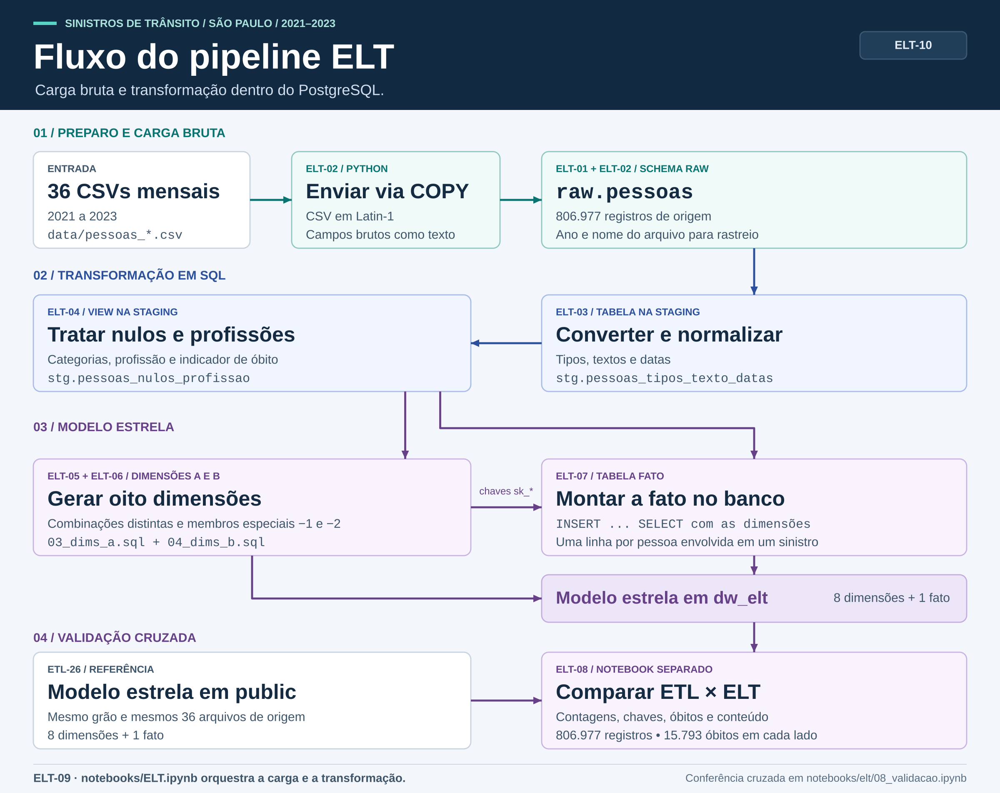

# 5. Comparativo ETL × ELT

As duas implementações partiram dos **36 CSVs mensais de 2021 a 2023** e produziram um modelo estrela com uma fato e oito dimensões. A diferença está na ordem e no local da transformação. A ETL transforma em **Python/pandas antes de carregar**. A ELT carrega os dados brutos e transforma em **SQL no PostgreSQL**.

| Aspecto | ETL | ELT |
| --- | --- | --- |
| Entrada e intermediários | CSVs lidos pelo Python. O tratamento e a modelagem geram Parquets em `data/intermediarios/`. | CSVs enviados via `COPY FROM STDIN` para `raw.pessoas`, com os campos da fonte como texto e duas colunas de rastreio. |
| Onde os dados são transformados | Em DataFrames, no ambiente onde o notebook roda. | No PostgreSQL. `stg.pessoas_tipos_texto_datas` guarda a primeira limpeza e `stg.pessoas_nulos_profissao` é uma view para a segunda. |
| Como o modelo estrela é construído | O Python monta as dimensões e a fato. O notebook cria as tabelas pelo DDL, carrega as dimensões e depois a fato via `COPY`. | O banco gera as dimensões a partir da staging e monta a fato com `INSERT ... SELECT` e os relacionamentos com as dimensões. |
| Resultado no banco | Schema `public`. | Schema `dw_elt`. |

*Fluxo dos dados na ELT. A validação cruzada usa a estrela da ETL em `public` como referência.* [Arquivo editável no draw.io](../../../docs/diagramas/fluxo_elt.drawio).

## 5.1 Tempo registrado

| Execução salva | Tempo | O que foi medido |
| --- | ---: | --- |
| [ETL-26](etl-26_notebook_completo.md) | **220,9 s** (3 min 41 s) | Total informado pela equipe para o notebook completo, incluindo a validação pós-carga da ETL-25. |
| [ELT-09](../../../notebooks/ELT.ipynb) | **335,9 s** (5 min 36 s) | Soma dos sete tempos registrados, da criação dos schemas à tabela fato. O notebook exibe **336 s** após arredondar. |

A ELT teve o maior tempo registrado, mas as duas medições **não têm o mesmo escopo**. O cronômetro da ELT não inclui o setup, a limpeza inicial dos schemas, as consultas de conferência disparadas depois das etapas nem a validação cruzada da ELT-08. Não se trata de um benchmark com hardware, rede, carga do servidor e limites de medição controlados.

Na ETL, a carga no PostgreSQL (ETL-24) somou **144,4 s** nas células da Etapa 09, segundo os metadados de execução do notebook. Na ELT, a maior etapa registrada foi **tipos, texto e datas (ELT-03), com 157,0 s**, cerca de 47% dos 335,9 s. Vieram em seguida a tabela fato (**63,7 s**) e a carga bruta dos CSVs (**56,5 s**). A carga final da ETL e a carga bruta da ELT não fazem o mesmo trabalho e, por isso, esses dois tempos não medem o mesmo procedimento.

## 5.2 Linhas de código

Foram contadas **linhas físicas não vazias** nas células de código e nos arquivos SQL, ignorando linhas que começam com `#` ou `--` após remover os espaços iniciais. SQL embutido no notebook entra na própria contagem do notebook. Docstrings em células de código entram na contagem. A métrica não inclui Markdown, saídas salvas, módulos auxiliares, scripts de montagem, notebooks avulsos de desenvolvimento ou os arquivos de validação gerados a partir de código já contado.

| Componente | ETL | ELT |
| --- | ---: | ---: |
| Notebook principal até a carga e suas conferências | 1.224 | 133 |
| SQL externo chamado pelo notebook | 233 no DDL da estrela | 1.197 nos seis arquivos de `sql/elt/` |
| **Subtotal até o modelo carregado** | **1.457** | **1.330** |
| Validação final | 83 na Etapa 10 do notebook | 98 no notebook separado da ELT-08 |
| **Total no escopo contado** | **1.540** | **1.428** |

O notebook da ELT ficou mais curto porque delega a transformação a arquivos SQL. Quando esses arquivos entram na conta, a diferença no escopo total é de **112 linhas**, não a diferença entre os tamanhos dos notebooks. Isso mede volume de código, não dificuldade de manutenção.

## 5.3 Conferência do resultado

As saídas salvas na [ELT-08](../../../notebooks/elt/08_validacao.ipynb) mostram que **as nove tabelas têm a mesma contagem** nos dois schemas, com **806.977 linhas na fato** e **15.793 óbitos**. As nove verificações de chaves estrangeiras da fato da ELT retornaram zero sem correspondência.

O `EXCEPT` nos dois sentidos não encontrou diferenças nas **colunas comuns de conteúdo**, sem as chaves substitutas `sk_*`. Para a fato ligada às dimensões, o notebook usou a quantidade de linhas e uma soma de hashes, que coincidiram. Essa conferência complementa o `EXCEPT` por tabela e não afirma igualdade numérica das chaves substitutas. As consultas estão em [`sql/validacao/elt_checks.sql`](../../../sql/validacao/elt_checks.sql).

## 5.4 Vantagens e desvantagens neste projeto

- **ETL.** Os diagnósticos em pandas e os Parquets deixam visível o resultado de cada transformação. A equipe consegue reabrir um intermediário e investigar um problema sem consultar o banco. Em contrapartida, o ambiente local precisa de memória e espaço para processar e gravar os arquivos, e a carga do modelo pronto ainda depende da rede e do PostgreSQL.
- **ELT.** Os dados brutos ficam disponíveis no banco para auditoria e para repetir a limpeza sem reenviar os CSVs, desde que `raw` seja preservado. Não há intermediários Parquet no fluxo, e o SQL concentra a transformação junto dos dados. Em contrapartida, a tabela bruta, a staging tipada, os índices e os arquivos temporários disputam recursos no servidor. O notebook da ELT-08 registra um caso concreto: o `EXCEPT` sobre a fato já ligada às dimensões excedeu o espaço em disco do Supabase e foi substituído pela conferência por soma de hashes.

No recorte observado, **a ETL teve o menor tempo registrado e a ELT teve menos linhas de código no escopo contado**. As validações registradas sustentam a consistência do resultado para as análises do projeto. A escolha entre as abordagens envolve onde é mais conveniente concentrar processamento, armazenamento e diagnóstico, não apenas qual notebook é menor.
