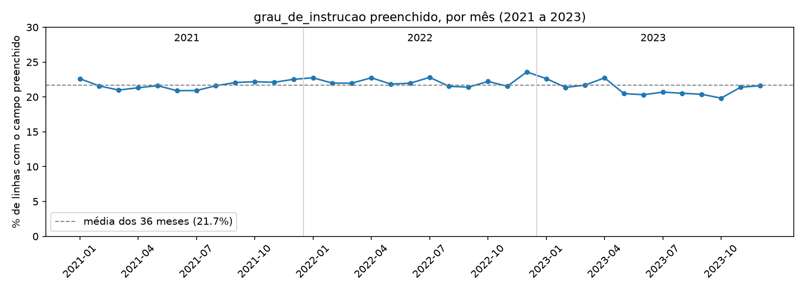

## Comparativo dos perfis de 2021, 2022 e 2023 (ETL-12)
### Diferenças nos dados ao longo do tempo (2021 a 2023)
    Antes de limpar a base, comparamos os três anos que a compõem para saber se um único conjunto de regras de tratamento serve a todos. Usamos os perfis de cada ano, que respondem às mesmas dez perguntas, e três resumos gerados a partir da base unificada, que detalham os valores por ano, os números por mês e por região. Nenhum dado foi alterado nesta etapa.

**Tabela 1.** Os três anos lado a lado.

| | 2021 | 2022 | 2023 |
| --- | --- | --- | --- |
| Linhas | 260.886 | 266.128 | 279.963 |
| Sinistros distintos | 128.207 | 132.358 | 142.130 |
| Óbitos | 4.858 | 5.445 | 5.490 |
| `grau_de_instrucao` nulo | 78,29% | 77,82% | 78,91% |
| `local_via` igual a `NAO DISPONIVEL` | 7,99% | 8,04% | 26,81% |
| `sexo` igual a `NAO DISPONIVEL` | 1,34% | 0,11% | 0,21% |
| Valores distintos de `profissao` (brutos / normalizados) | 515 / 504 | 588 / 482 | 658 / 485 |

**Estrutura e volume.** Os três anos têm as mesmas 31 colunas, na mesma ordem, sem colunas novas ou ausentes. O volume cresce de 260.886 para 266.128 linhas (+2,0%) e 279.963 (+5,2%), somando 806.977, o mesmo total da extração. Os 15.793 óbitos coincidem com as linhas de gravidade FATAL, e as sete colunas de óbito são nulas nas mesmas linhas em todos os anos. Dentro de cada ano, `id_pessoa` é único e não há linhas idênticas.

**Categorias.** Nenhuma categoria relevante surgiu ou sumiu. As seis colunas categóricas centrais (gravidade da lesão, tipo de vítima, sexo, tipo de via, tipo de veículo e região administrativa) têm o mesmo conjunto de valores nos três anos, e a união dos anos contém os 645 municípios do Estado. O número de profissões distintas parece crescer (515, 588 e 658), mas o aumento vem da grafia: a partir de 2022 surgem valores em caixa mista, ao lado dos valores em maiúsculas, em 0,19% das linhas em 2022 e 1,05% em 2023 (0,00% em 2021). Depois de normalizar a caixa, os acentos e a pontuação, o número de valores fica estável (504, 482 e 485).

**Preenchimento de `grau_de_instrucao`.** O campo é preenchido em cerca de 22% das linhas em todos os 36 meses, de 19,83% a 23,59% (Figura 1). Não há um período em que ele seja confiável, e janeiro de 2021, que parecia bem preenchido nas amostras iniciais, é apenas o sétimo maior mês da série. O que explica o nulo é o tipo de vítima: o campo é preenchido em cerca de 82% dos pedestres, 35% dos passageiros e 1% dos condutores, com valores quase iguais nos três anos. Os condutores são 46% a 47% das linhas e respondem por menos de 3% dos valores preenchidos.

**Figura 1.** Percentual de linhas com `grau_de_instrucao` preenchido, por mês.

**Valores `NAO DISPONIVEL` e nulos.** As mudanças ocorrem em datas precisas, e não de forma gradual. Em `local_via`, o `NAO DISPONIVEL` fica em torno de 8% até março de 2023 e passa a 25% a 38% de maio a dezembro de 2023. O salto ocorre nas 16 regiões e em todos os tipos de vítima, e 96% do aumento está em vias urbanas. Em `sexo`, o `NAO DISPONIVEL` cai de 1,39% em dezembro de 2021 para 0,06% em janeiro de 2022. Em 2023, os nulos de `profissao` e de `nacionalidade` sobem cerca de 2,9 e 2,7 pontos percentuais em relação a 2022.

**Texto.** Os três anos têm os mesmos defeitos. Os mesmos 8 municípios aparecem com o apóstrofo trocado por espaço (por exemplo, `SANTA BARBARA D OESTE`), e todos os valores de `nacionalidade` têm espaços no fim. Não há acentos corrompidos: os arquivos não são UTF-8 e foram lidos como `latin-1` com os acentos corretos.

**Consequências para o processo de ETL.**

- Um único conjunto de regras e um único mapa de correção de texto servem aos três anos.
- As dimensões de localidade, de profissão e de perfil da vítima devem ser construídas com a união dos três anos, e as profissões precisam ser padronizadas (maiúsculas e sem acento) antes de agrupar.
- Na etapa de nulos, `NAO DISPONIVEL` e nulo devem ser unificados em `NÃO INFORMADO` coluna a coluna, e o nulo de `grau_de_instrucao` deve ser tratado como estrutural por tipo de vítima, e não por período.
- O `local_via` de maio de 2023 em diante não é comparável ao período anterior, e as análises por local da via devem separar os dois períodos.

**Limitações.** Os dados mostram quando e onde as mudanças ocorrem, mas não por quê: a causa só pode ser confirmada na documentação da fonte. A repetição de `id_pessoa` entre anos e o mês em que começa a caixa mista de `profissao` ainda não foram verificados.